# ADK-Rust 3: a walkthrough of the home, genui and adk-ui 3

This walkthrough shows what was built for ADK-Rust 3's people-facing side, screen by screen. It has three parts:

1. **The web home, redesigned:** where people watch, steer and approve their agents.
2. **genui:** agents draw UI on A2UI 1.0, and every action they draw still asks first.
3. **adk-ui 3:** rich catalogs agents draw with: charts, pages, and 3D.

Every screenshot was taken from the code in review, in a real browser. Most come from the home's example data, and the 3D yard comes from a scripted agent. Nothing here is a mock-up.

| | Where | Status |
|---|---|---|
| The home, genui | [zavora-ai/adk-rust#1499](https://github.com/zavora-ai/adk-rust/pull/1499) (`feat/genui-sota`) | In review |
| adk-ui 3 | [zavora-ai/adk-ui#4](https://github.com/zavora-ai/adk-ui/pull/4) (`v3-sota`) | In review; needs the adk-rust PR and the ADK-Rust 3.0 release first |

> **For the playground:** the website playground runs published ADK-Rust **v2** examples. Once ADK-Rust 3.0 and adk-ui 3.0 are on crates.io, adk-ui's `capabilities_tour` example (a scripted, guided tour of everything in Part 2) is the natural first v3 entry. Until then, run it locally as shown at the end.

---

## Part 1: the web home, redesigned

The home was redesigned as **calm mission control**:
- quiet surfaces, with Geist and Geist Mono over warm neutrals;
- a single accent colour, reserved for "this needs you" and the primary action;
- a layered dark theme;
- a type scale, radii and motion that respect reduced-motion settings.

Every screen passes axe at WCAG 2.1 AA in light and dark.

### Today: what happened while you were away

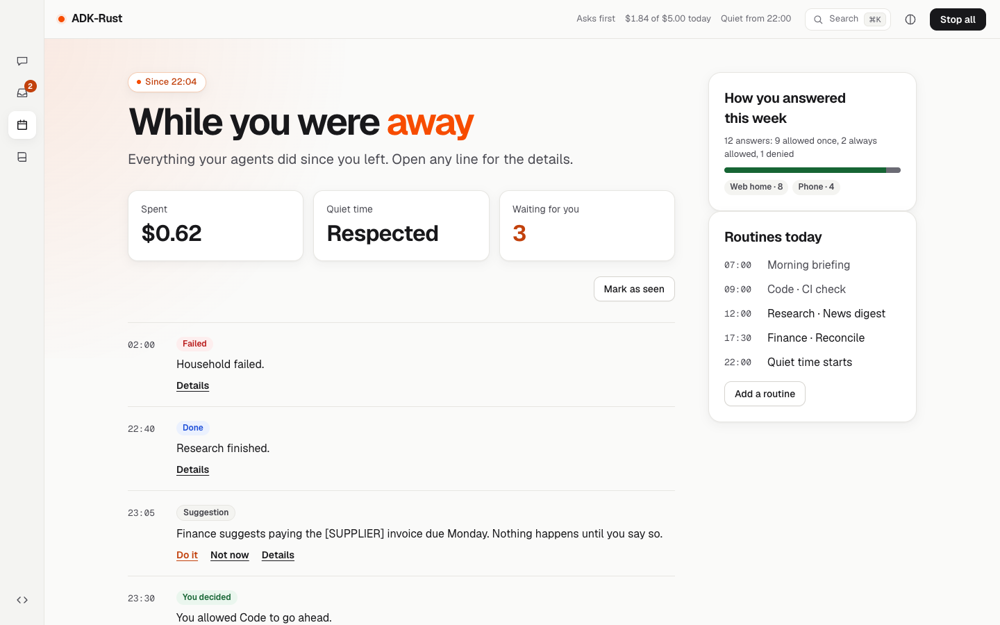

Today opens with what your agents did since you left: what was spent, whether quiet hours were respected, and what waits for you. Each event below can be opened for details. On the right:
- **How you answered this week** counts your approvals (allowed once, always allowed, denied) and where you gave them, from `GET /surface/answers`.
- **Routines today** lists your scheduled jobs.

The sections now live in an **icon rail** on the left. Each icon keeps its name as a tooltip and for screen readers, and the Decisions icon carries a count.

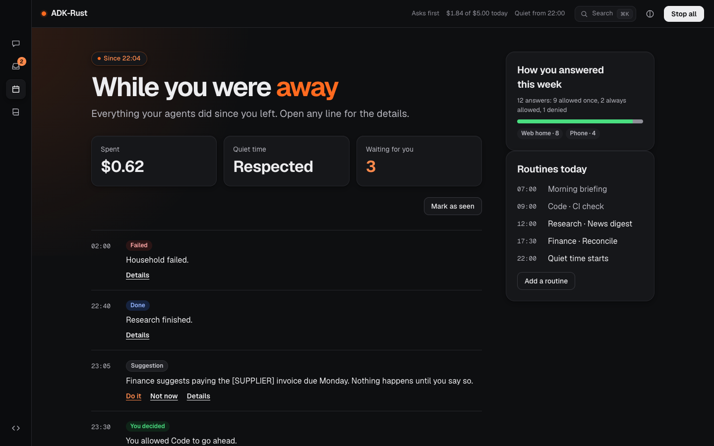

### A thread, and a decision that leads with its question

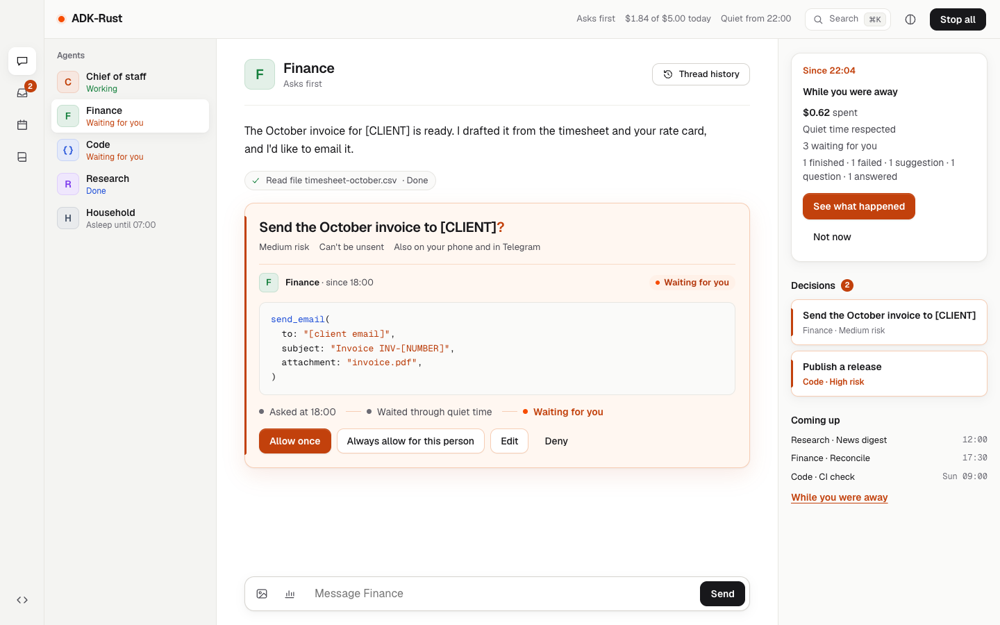

A decision card now reads **question first**: "Send the October invoice to [CLIENT]?" Under the question:
- what it costs: the risk, whether it can be undone, and where else it can be answered;
- who asks;
- the exact call that will run;
- its timeline.

The card offers four answers: **Allow once**, **Always allow for this person**, **Edit** and **Deny**. The home never decides for you. Text typed while a decision is open is queued as your next message; it is never taken as an answer.

### What an agent ran, and where it ran

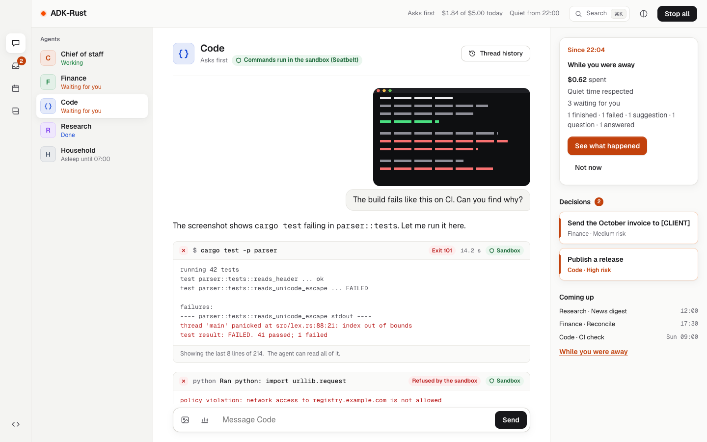

When an agent runs a command (`bash` or `sandbox_exec`), the result reads as a **run card**:
- the command and its exit code, and how long it took;
- the last lines of output, with stderr in red;
- where it ran.

The thread header says where this agent's commands run: in an OS sandbox (Seatbelt here), a container, a remote machine, this computer, or nowhere. A command the sandbox refused is shown as refused.

The message at the top carries an **image**: people can now send screenshots to their agents.

### Sending images

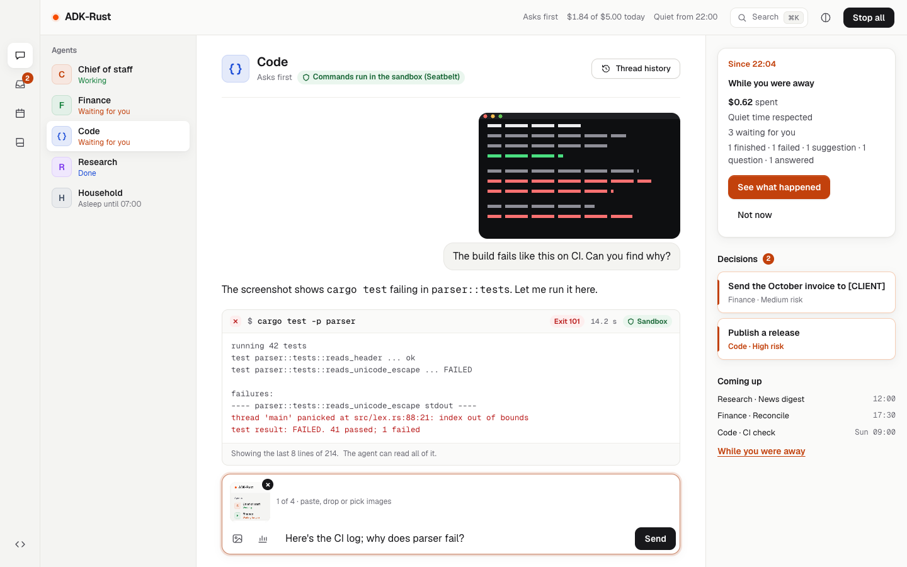

Pick, paste or drop up to four images (PNG, JPEG, WebP or GIF) into the message box. The engine:
- checks each image's bytes against its declared type, and refuses one that's too large;
- never steers a message with images into a running turn: it waits for the next turn.

`Command::Send`, `Queue` and `NewThread` gained `images`. The local source hands them to the model as content parts, through the kernel or the new `Harness::send_content_as`.

### Decisions: one inbox for everything that waits

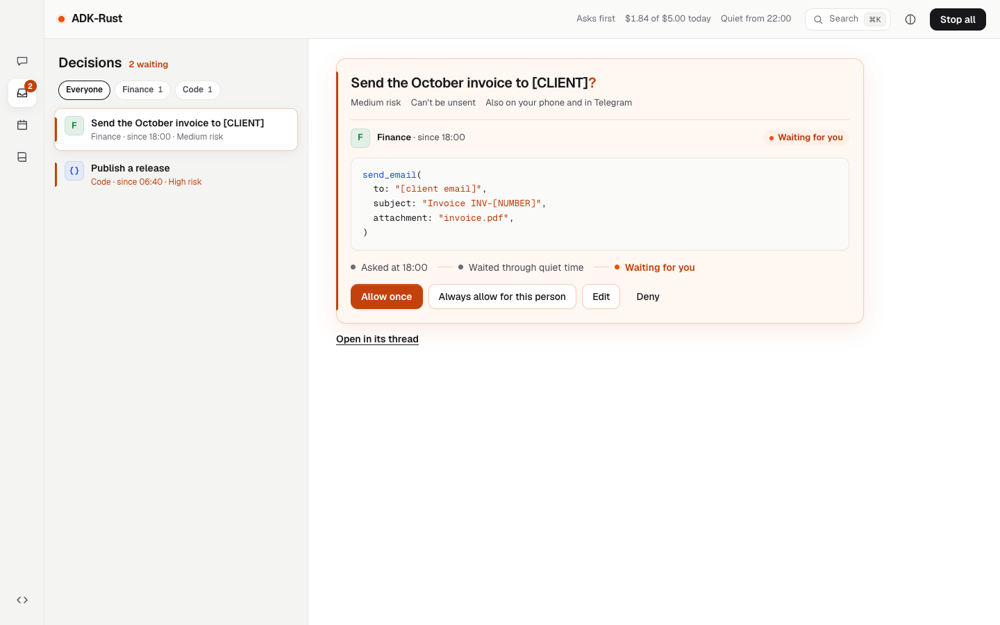

**Decisions** (`/ui/decisions`) gathers every waiting decision across agents. You can filter it by agent, answer in place, or open a decision in its thread.

### ⌘K: search and jump

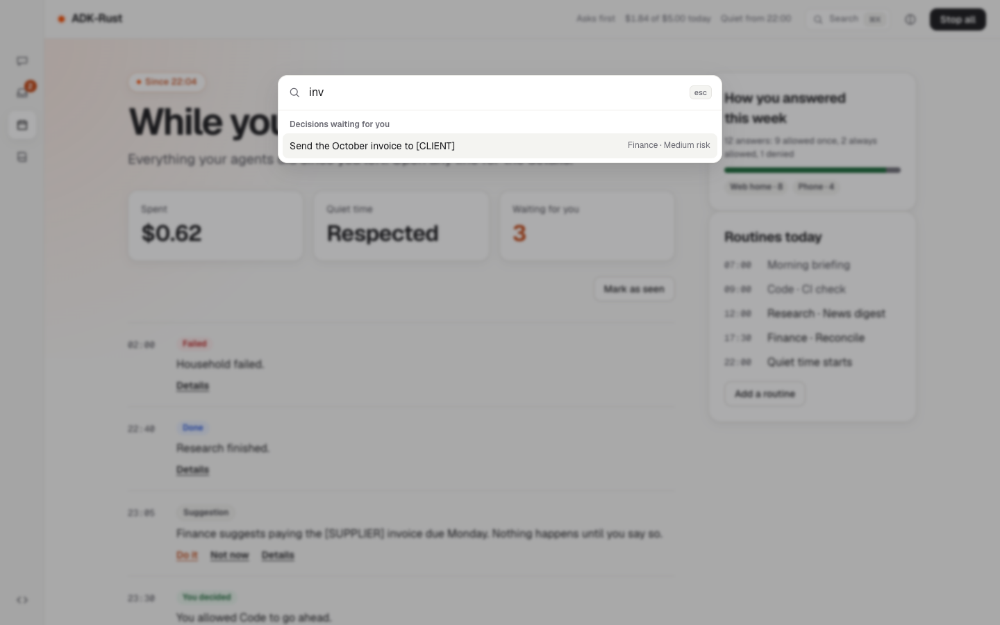

**⌘K** (Ctrl+K on Windows and Linux) finds an agent's thread, a waiting decision or a section, plus a few actions such as switching the theme or adding an agent. It jumps to a decision but never answers it.

### Show a drawing beside the thread

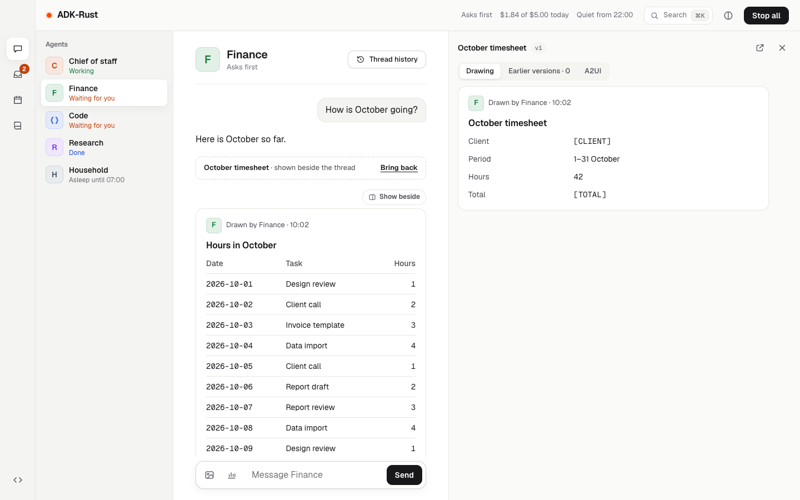

Any drawing can be shown **beside the thread** in a canvas. The canvas keeps the latest version, earlier versions and the drawing's A2UI in tabs. The thread keeps a line that brings the drawing back. The canvas can also open in **its own window** (`/ui/canvas?session=…&surface=…`), which follows the session live.

### The developer view: graph, tree and trace

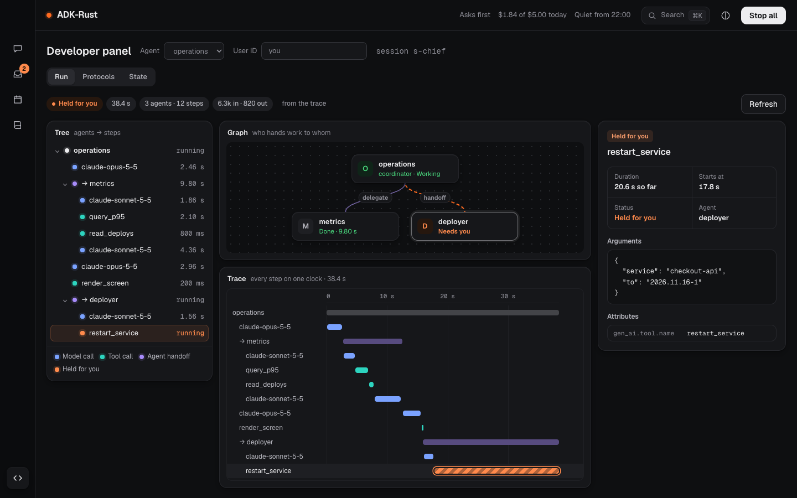

For multi-agent systems, the **Developer** panel's Run view shows one run three ways, from the session's spans and events:
- **Tree:** agents, then their steps (model calls, tool calls, handoffs), each with its duration.
- **Graph:** who hands work to whom (delegate and handoff edges), with each agent's state.
- **Trace:** every step on one clock, so overlaps and waits stand out.

The inspector shows the selected step's status, arguments and attributes. A call **held for you** is marked in all three views. The panel loads only when you open it.

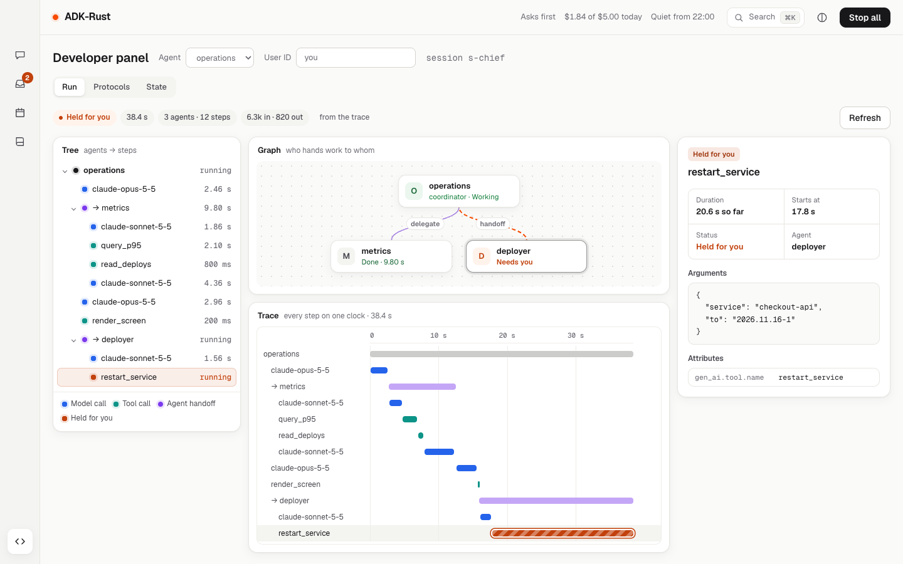

### Voice: talk to your agents

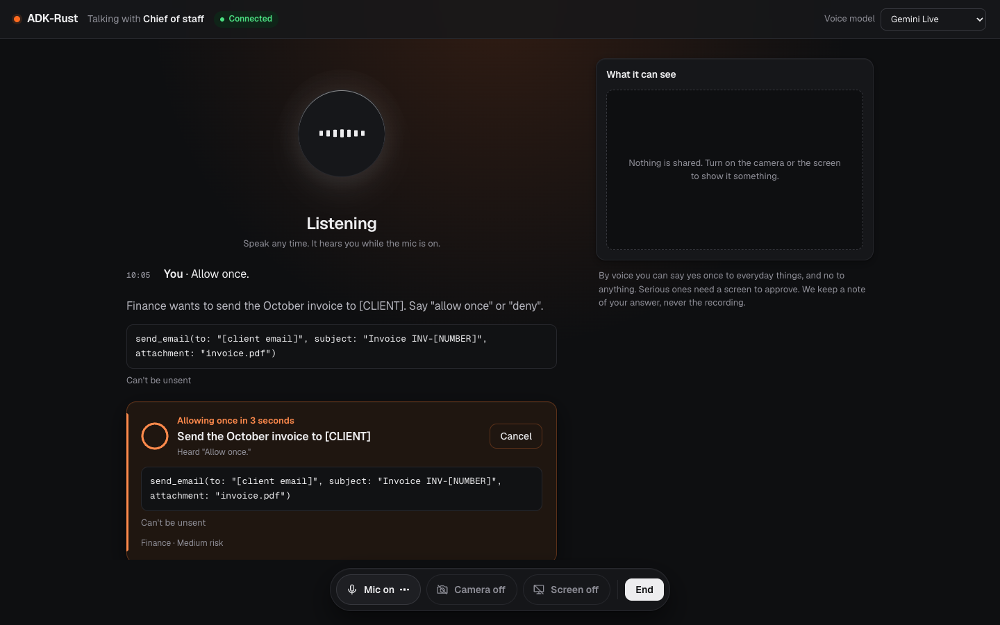

The voice view:
- **listens:** the presence follows real loudness;
- **captions** both sides;
- shows **what it can see** when you turn on the camera or share the screen;
- lists the frames actually sent to the model.

A spoken "allow once" runs a **countdown you can cancel**. Serious decisions still need a screen.

### Phone and tray

| | |
|---|---|
| 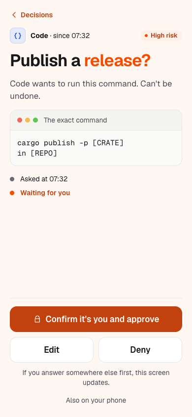 | 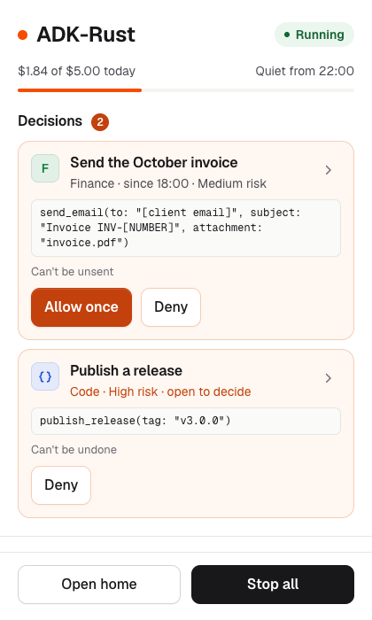 |
| The phone leads with the question too | The tray panel |

### Also new in the home

- **Stop the turn:** a Stop button in the message box while the agent works (`Command::StopTurn`). The stop is recorded in the audit log.
- **Suggested replies:** agents can offer up to four short replies with the `suggest_replies` tool (`adk_surface::suggest::SuggestReplies`). Tapping one fills the message box and never sends it.
- **Thread history:** earlier threads with an agent, from `GET /surface/agents/{id}/threads`.
- **Work log:** three or more plain steps in a row fold into one line saying how many steps ran, how many failed and how long they took.
- **Ask for a drawing:** puts a drawing request in the message box. It's only sent when you press Send.
- **The terminal home** follows the same palette and shows images, runs and suggestions as text.

---

## Part 2: agents that draw (genui on A2UI 1.0)

genui lets an agent **draw UI** (forms, tables, charts, 3D) in the home. One rule holds throughout: **a drawing only shows; anything it does is a call the person approves**.

### A drawn form, and every state it goes through

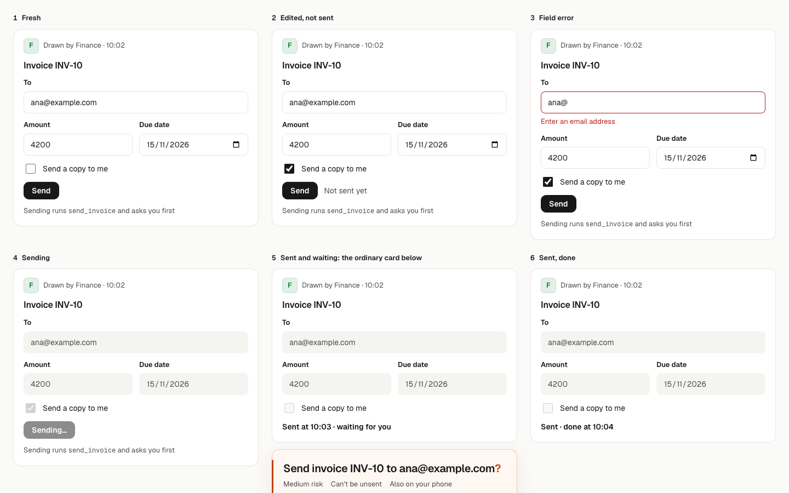

An agent draws a form with genui's render tools. The person edits it and presses **Send**. Send doesn't run anything itself: it asks for the call on the home's ordinary decision card. Each state is shown plainly:
- fresh, edited, a field error;
- sending, then sent and waiting;
- done.

### The approval card, sealed to what you saw

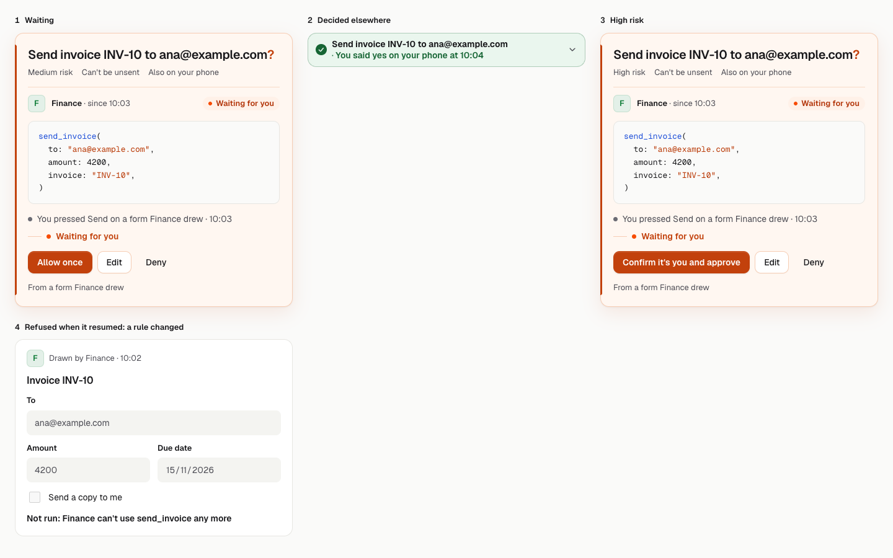

When a drawn form's Send asks for a call, the card says it came "from a form Finance drew". Your yes is **sealed** (HMAC) to the exact drawing and arguments you saw, and is checked before the call runs. A high-risk call asks you to confirm it's you. If a rule changes before the call resumes, it isn't run, and the card says why.

### Drawings that look like decisions are refused

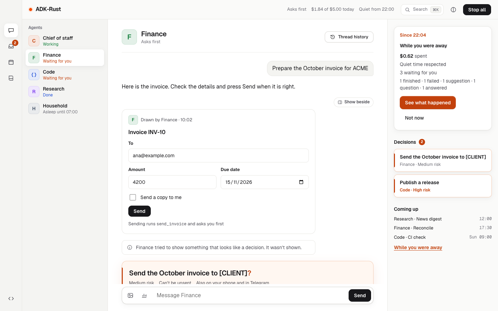

The server checks every drawing before it's shown. A drawing that imitates the home's own controls, such as approve buttons, decision colours or a decision's words, is **refused** and never reaches the screen. Drawings that pressure people (urgency, scarcity, countdowns) get **dark-pattern warnings** for the agent.

### Apps from MCP servers

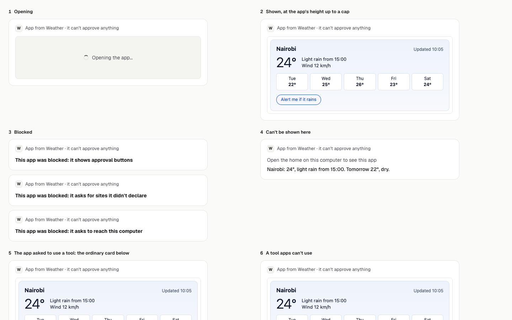

MCP Apps run sandboxed, on their own origin, and can't approve anything:
- an app that shows approval buttons, asks for undeclared sites, or tries to reach this computer is **blocked**;
- tool calls an app asks for are held for the person, like any other call;
- consent comes in tiers, with standing approval tied to the tool's definition.

### 3D, drawn natively in the home

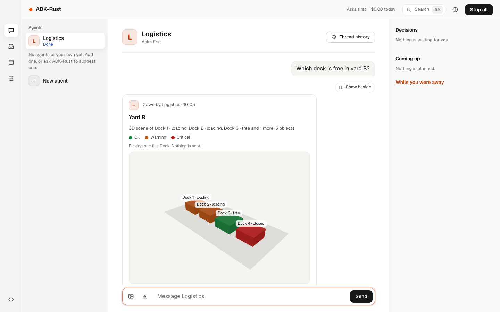

Scenes render with WebGL in a lazily loaded chunk, and the server checks them first:
- colours come from the home's palette, never hex, and every state colour carries a label;
- labels are page text;
- nothing loads from outside, and everything is capped.

**Picking an object fills a choice field the drawing shows. Nothing is sent.** The drawing's own Send still asks first. Without WebGL, the scene is shown as words.

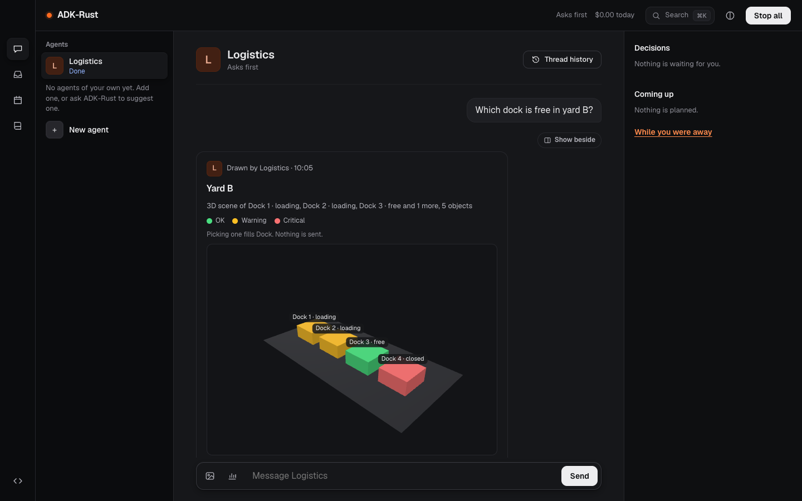

### Under the hood

- **A2UI 1.0 on the wire** (0.9.1 still negotiated), with rule 5 in A2UI 1.0's terms; catalogs are A2UI 1.0 documents.
- **Function calls:** `callAgentFunction` is answered with `INVALID_FUNCTION_CALL`, since genui defines none.
- **Live updates:** `patch_surface` reports what changed, keeps to a budget of 30 patches a minute, and carries a delta (`DrawnEnvelope::delta_from`).
- **A display-only extension** (`adkrust_display_only`), claimed on every drawing.
- **MCP elicitation:**
  - a server's form is answered in the home's own fields;
  - a server's address is shown whole, with a look-alike warning.
- **Chat cards:** drawings rendered as Slack Block Kit and Teams Adaptive Cards (`chat_cards`).
- **AG-UI 1.0** run shape in `adk-server` for clients that name it.
- **Accessibility is part of the contract:** labelled fields, and a data table under every chart.

---

## Part 3: adk-ui 3, catalogs agents draw with

adk-ui 3 extends genui with three catalogs. Each catalog includes the previous one:

| Catalog | Adds |
|---|---|
| **insight** | `Chart` (bar, line, area, pie, scatter), `VegaLite` (a Vega-Lite subset drawn as the home's chart), `Sparkline`, `Metric`, `KeyValue`, `Progress`, `Badge` |
| **studio** | `App` (pages the host navigates), `Page`, `Region`, `Scene3D` |
| **spatial** | 3D charts (`Bar3D`, `Scatter3D`, `SurfacePlot`, `Graph3D`, `Globe`), `Scene` (groups, lines, lights, motion, panels; picking fills a choice field), `DepthCard` (tilt, flip, layers), `Stage` (stage, wall, carousel) |

Nine of adk-ui's eleven sample drawings, as the home draws them:

| | | |
|---|---|---|
| 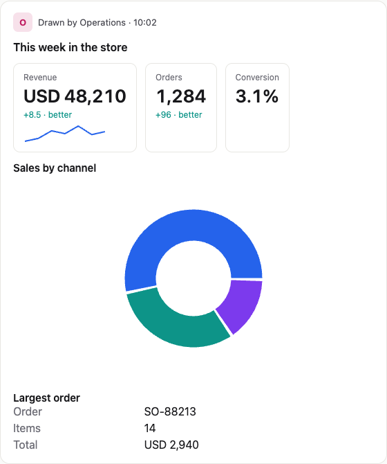 | 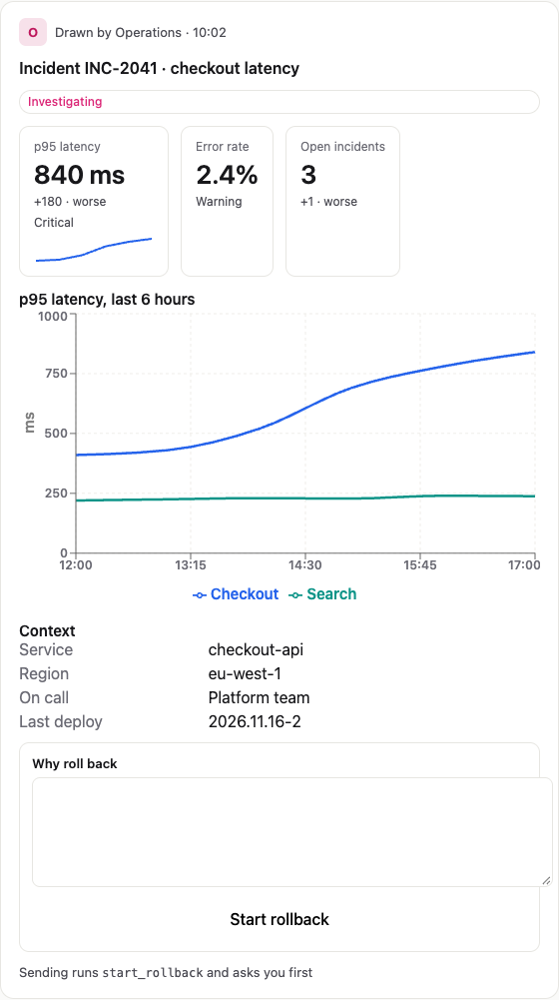 | 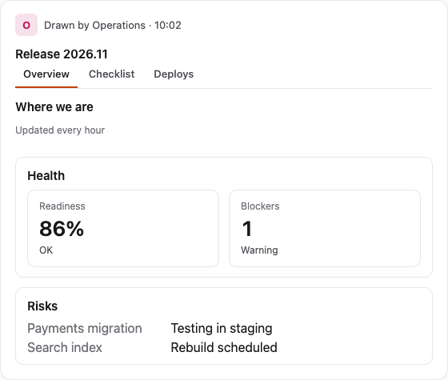 |
| **studio:** a week in the store | **studio:** incident command | **studio:** a release room, as an `App` |
| 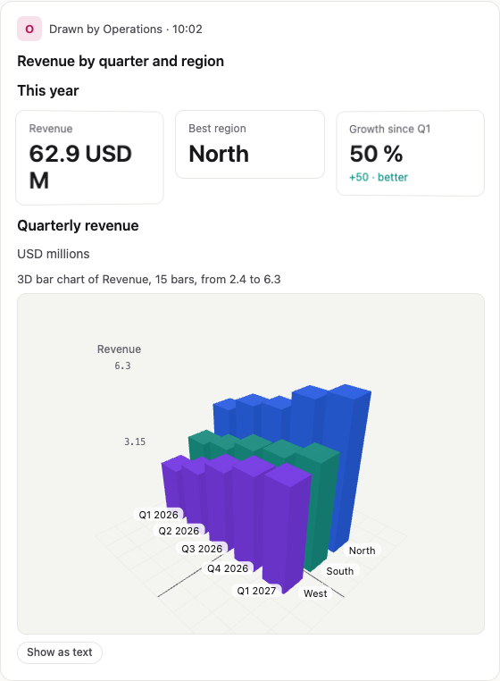 | 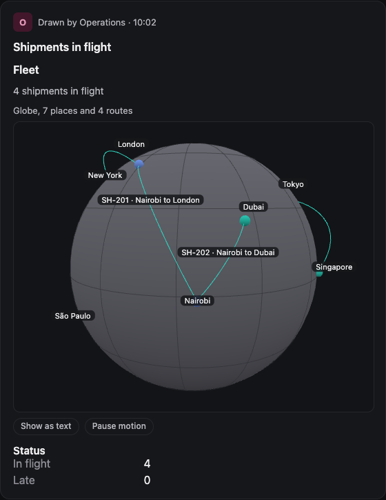 | 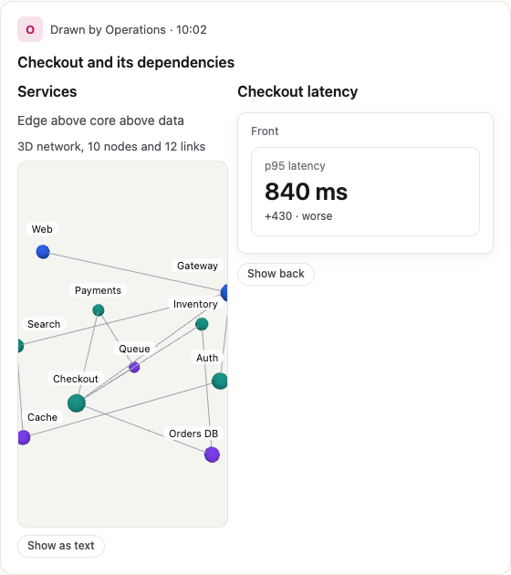 |
| **spatial:** revenue in 3D bars, in a `Stage` | **spatial:** a fleet on a `Globe` (dark) | **spatial:** a `Graph3D` beside a flipping `DepthCard` |
| 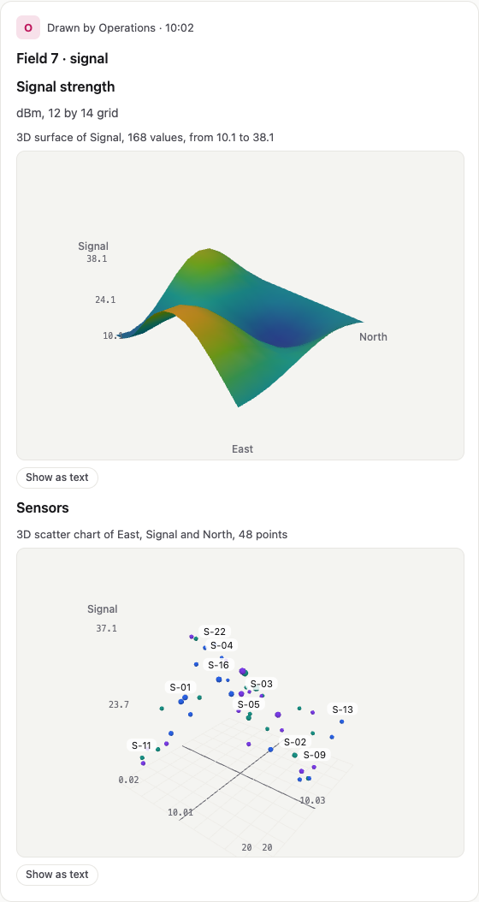 | 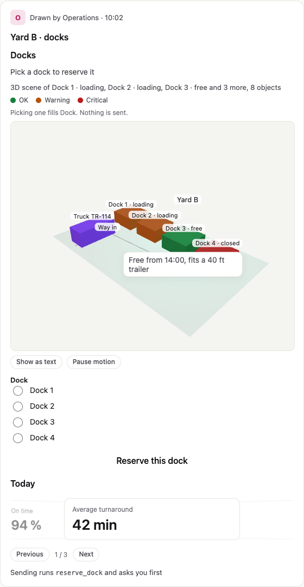 | 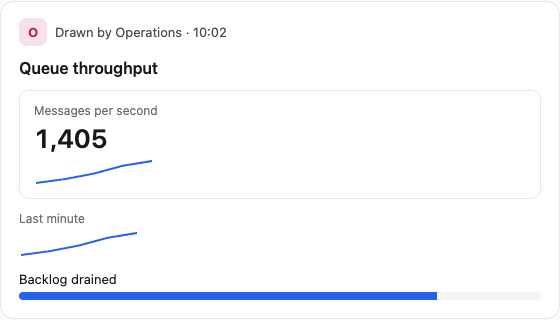 |
| **spatial:** terrain as a `SurfacePlot` and a `Scatter3D` | **spatial:** pick a dock, then reserve it (asks first) | **studio:** live throughput |

### Using it

```rust
// The agent draws with genui's render tools, in adk-ui's spatial catalog (all three).
let agent = HarnessAgent::builder("operations")
    .model(model)
    .toolset(Arc::new(adk_ui::toolset_for(adk_ui::catalogs::spatial())))
    .instruction(adk_ui::prompts::instructions(adk_ui::catalogs::spatial()))
    .build()?;

// The home shows what it draws.
let engine = adk_ui::catalogs::register(SurfaceEngine::builder(Arc::new(source))).build();
```

Builders write the same JSON in Rust:

```rust
use adk_ui::spatial::{Motion, Object, Scene};

let yard = Scene::new("yard")
    .object(Object::new("dock-3", "box", [3.0, 0.5, 0.0]).label("Dock 3 · free").state("ok")
        .motion(Motion::pulse(2.0)).value("dock-3"))
    .pick_into("/dock")
    .build();
```

### Also in adk-ui 3

- **MCP Apps** (`--features apps`, the `adk-ui-apps` binary):
  - `show_drawing` frames a checked drawing read-only in any MCP Apps host;
  - `show_3d_app` runs model-written three.js in the sandbox and refuses code that imports, fetches, or shows a decision's words.
- **Measuring drawings:** `adk_ui::eval` scores a drawing the way genui will judge it, from 0 to 100 points (`cargo run --example drawing_eval`). It exits non-zero when a drawing is refused, so a CI job can gate prompt changes on it.
- **Your own host:** `@zavora-ai/adk-surface-react`'s `DrawnView` with adk-ui's renderers and approved **brand kits** (`KitProvider`).
- **A real agent:** `insight_agent` studies a directory with its own tools and answers in charts, pages and 3D, on Claude.

---

## Try it yourself

From an adk-rust checkout of `feat/genui-sota`:

```bash
# The home's example, every screen, no kernel.
cd adk-surface/web && npm ci && npx vite --port 8800
#   http://127.0.0.1:8800/ui/fixture.html?section=today
#   …?section=threads   …?section=decisions   …?screen=developer
#   …?screen=voice      …?screen=phone&phone=decide
#   …?screen=genui&genui=states   …?screen=genui&genui=card-states   …?screen=genui&genui=app-states

# A scripted agent that draws the 3D yard: open /ui/ and ask "Which dock is free in yard B?"
cargo run -p adk-surface --features web,genui --example scripted_genui_scenes -- 8807 /tmp/yard
```

From an adk-ui checkout of `v3-sota`, with `.cargo/config.toml` pointing at that adk-rust checkout (see `.cargo/config.toml.example`):

```bash
# The guided tour of Part 2: http://127.0.0.1:8810/ui/
cargo run --features apps --example capabilities_tour

# The eleven sample drawings in a host of your own.
cd examples/custom_host && npm install && ADK_SURFACE_ROOT=<adk-rust>/adk-surface npm run dev

# A real agent on Claude, answering with charts and 3D.
ANTHROPIC_MODEL=claude-opus-5-5 AGENT_WORKSPACE=$PWD cargo run --example insight_agent
```

## How it was checked

- **adk-surface:**
  - 671 Rust tests pass with every feature, clippy is clean, and the API drift check passes;
  - the workspace pre-commit hook passes.
- **The web home:** 443 unit tests, the build, and the chunk budget pass. All 15 Playwright projects pass (61 tests), including axe at WCAG 2.1 AA over every screen in light and dark.
- **adk-ui:** it compiles against the adk-rust branch with every feature, and its home and apps tests pass.
